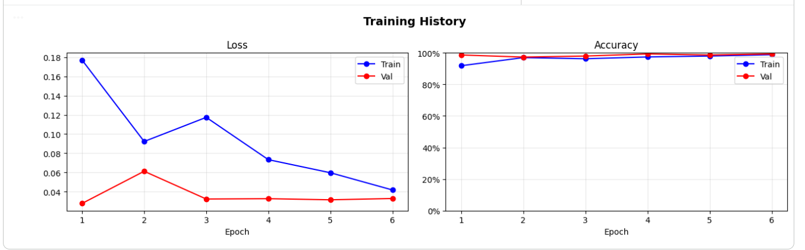
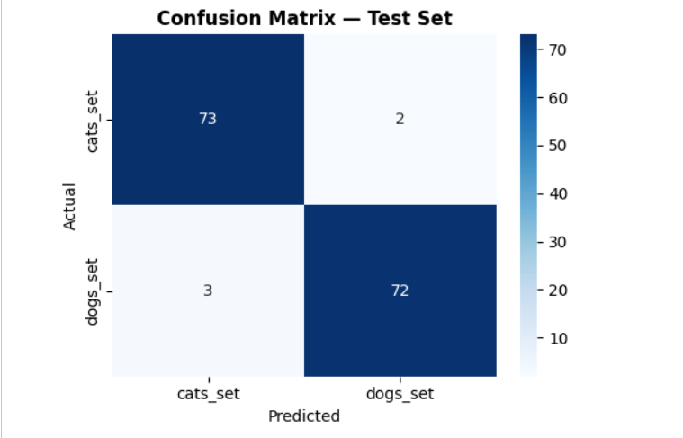
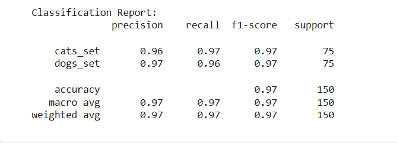
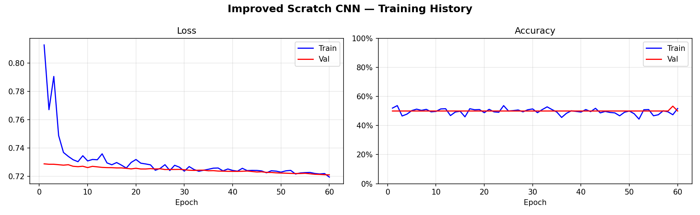
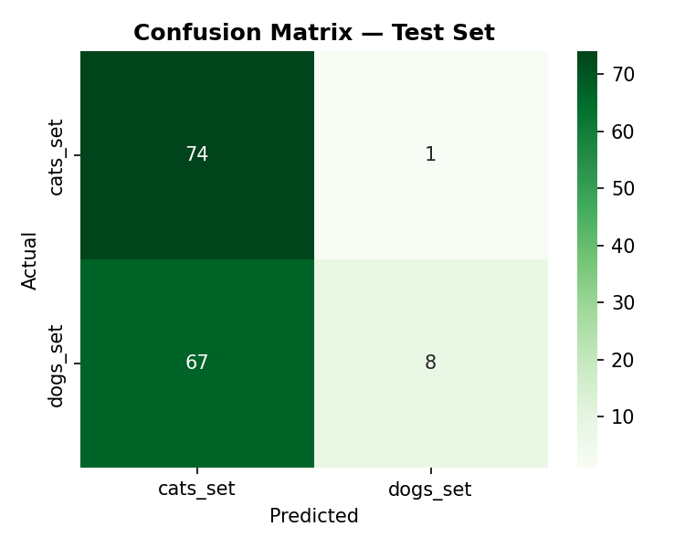

# 🐱🐶 Cat & Dog Classification: Method & Architecture Comparison

[](https://opensource.org/licenses/MIT)
[](https://www.python.org/downloads/)
[](https://www.tensorflow.org/)
[](https://streamlit.io/)
[](https://github.com/psf/black)
[](https://github.com/KazimMammadli)

An end-to-end deep learning comparative study and interactive evaluation platform analyzing two distinct computer vision paradigms on small-sample image datasets (~1,000 images):
1. **Custom Convolutional Neural Network (CNN)** trained entirely from scratch.
2. **Transfer Learning via MobileNetV2** pre-trained on ImageNet.

Includes production-ready modular Python packages, CLI tools for training and evaluation, an interactive Streamlit web application, Docker containerization, and clean reproducible Jupyter notebooks.

---

## 📊 Key Findings & Comparative Benchmarks

When dataset size is constrained, training a deep neural network from scratch struggles to establish generalizable low-level feature representations. Transfer learning overcomes this data scarcity bottleneck by fine-tuning pre-trained ImageNet representations.

| Metric | Custom CNN (From Scratch) | MobileNetV2 (Transfer Learning) | Relative Improvement |
| :--- | :---: | :---: | :---: |
| **Test Accuracy** | **54.67%** | **96.67%** | **+42.00%** |
| **Test Loss** | `0.7211` | `0.0993` | **-86.23%** |
| **Validation Accuracy** | `53.33%` | `99.33%` | **+46.00%** |
| **Macro F1-Score** | `0.44` | `0.97` | **+120.45%** |
| **Cat Precision / Recall** | `0.52 / 0.99` | `0.97 / 0.96` | Balanced, high precision |
| **Dog Precision / Recall** | `0.89 / 0.11` | `0.96 / 0.97` | Eliminated extreme recall bias |
| **Optimal Epoch** | Epoch 59 (60 total) | **Epoch 4** (Early stop at 6) | **15x Faster Convergence** |

> 📖 **Full Technical Analysis**: A detailed scientific write-up is available in [docs/COMPARATIVE_ANALYSIS.md](docs/COMPARATIVE_ANALYSIS.md).

---

## 📈 Visual Benchmark Results

### MobileNetV2 (Transfer Learning) — 96.67% Accuracy
| Training Dynamics & Convergence | Confusion Matrix | Classification Report |
| :---: | :---: | :---: |
|  |  |  |

### Custom CNN (From Scratch) — 54.67% Accuracy
| Training Dynamics & Plateau | Confusion Matrix (Heavy Bias) |
| :---: | :---: |
|  |  |

---

## 🏗️ Architecture Overview

### 1. Custom CNN (From Scratch)
- **Input**: `(160, 160, 3)` RGB images.
- **Backbone**: 3 sequential convolutional blocks:
  - Block 1: `Conv2D(32, 3x3)` $\to$ `BatchNormalization` $\to$ `ReLU` $\to$ `MaxPooling2D(2x2)` $\to$ `Dropout(0.3)`
  - Block 2: `Conv2D(64, 3x3)` $\to$ `BatchNormalization` $\to$ `ReLU` $\to$ `MaxPooling2D(2x2)` $\to$ `Dropout(0.3)`
  - Block 3: `Conv2D(128, 3x3)` $\to$ `BatchNormalization` $\to$ `ReLU` $\to$ `MaxPooling2D(2x2)` $\to$ `Dropout(0.4)`
- **Head**: `Flatten` $\to$ `Dense(128, L2)` $\to$ `BatchNormalization` $\to$ `Dropout(0.5)` $\to$ `Dense(1, sigmoid)`.
- **Optimization**: Adam (`lr=1e-3`), `BinaryCrossentropy`, `ReduceLROnPlateau`, `EarlyStopping`.

### 2. MobileNetV2 (Transfer Learning)
- **Input**: `(160, 160, 3)` RGB images with Keras `mobilenet_v2.preprocess_input`.
- **Backbone**: ImageNet pre-trained base (`weights='imagenet'`, `include_top=False`, frozen layers).
- **Head**: `GlobalAveragePooling2D` $\to$ `Dense(128, relu)` $\to$ `Dropout(0.3)` $\to$ `Dense(1, sigmoid)`.
- **Optimization**: Adam (`lr=1e-4`), `BinaryCrossentropy`, `ModelCheckpoint`, `EarlyStopping`.

---

## 📁 Repository Structure

```
cat_and_dog_classification_method_comparison/
├── app/
│   └── app.py                  # Interactive Streamlit Web Application
├── docs/
│   └── COMPARATIVE_ANALYSIS.md # Detailed experimental report
├── models/
│   └── custom_cnn_best.keras   # Trained Custom CNN weights
├── notebooks/
│   ├── 01_custom_cnn_from_scratch.ipynb        # Clean scratch training notebook
│   └── 02_transfer_learning_mobilenetv2.ipynb  # Clean transfer learning notebook
├── outputs/
│   ├── custom_cnn_confusion_matrix.png
│   ├── custom_cnn_history.png
│   ├── mobilenetv2_classification_report.png
│   ├── mobilenetv2_confusion_matrix.png
│   └── mobilenetv2_history.png
├── scripts/
│   ├── evaluate.py             # CLI model evaluation on test sets
│   ├── predict.py              # Single/batch image inference script
│   └── train.py                # Command-line training pipeline
├── src/
│   ├── __init__.py
│   ├── data/
│   │   ├── __init__.py
│   │   └── dataset.py          # Data loading, splitting, and augmentation
│   ├── evaluation/
│   │   ├── __init__.py
│   │   ├── metrics.py          # Classification metrics computation
│   │   └── visualize.py        # Curves & confusion matrix plotting
│   ├── inference/
│   │   ├── __init__.py
│   │   └── predictor.py        # High-level CatDogPredictor engine
│   ├── models/
│   │   ├── __init__.py
│   │   ├── custom_cnn.py       # Custom CNN model architecture
│   │   └── mobilenet.py        # MobileNetV2 transfer learning model
│   └── training/
│       ├── __init__.py
│       └── trainer.py          # Standardized Keras training loop
├── tests/
│   ├── __init__.py
│   ├── test_components.py      # Module import & structure tests
│   ├── test_inference.py       # Inference pipeline unit tests
│   └── test_models.py          # Model architecture unit tests
├── .gitattributes              # Linguist language bar overrides
├── .gitignore                  # Git ignore rules
├── Dockerfile                  # Containerized application build
├── docker-compose.yml          # Container orchestration
├── LICENSE                     # MIT License
├── pyproject.toml              # Build & package metadata
├── requirements.txt            # Python dependencies
├── run_app.bat                 # Windows one-click launcher
└── run_app.sh                  # Linux/macOS one-click launcher
```

---

## 🚀 Quick Start & Installation

### 1. Prerequisites
- Python 3.10 or higher
- Git

### 2. Clone the Repository
```bash
git clone https://github.com/KazimMammadli/cat_and_dog_classification_method_comparison.git
cd cat_and_dog_classification_method_comparison
```

### 3. Create a Virtual Environment & Install Dependencies
```bash
python3 -m venv venv
source venv/bin/activate  # On Windows: venv\Scripts\activate
pip install -r requirements.txt
```

---

## 🖥️ Running the Interactive Web App

Launch the Streamlit web dashboard to upload images, test predictions, and inspect architecture comparisons:

```bash
# Using the bash launcher
./run_app.sh

# Or on Windows
run_app.bat

# Or directly with Streamlit
streamlit run app/app.py
```

Open your browser at `http://localhost:8501`.

### 🐳 Running with Docker
```bash
# Build and run with Docker Compose
docker compose up --build

# Or with Docker directly
docker build -t cat-dog-classifier .
docker run -p 8501:8501 cat-dog-classifier
```

---

## 💻 Command Line Interface (CLI)

### Train a Model
```bash
# Train Custom CNN from scratch
python3 scripts/train.py --model custom_cnn --epochs 60 --batch-size 32

# Train MobileNetV2 via Transfer Learning
python3 scripts/train.py --model mobilenet --epochs 15 --batch-size 32
```

### Predict on an Image
```bash
# Run prediction with Custom CNN
python3 scripts/predict.py --image path/to/sample.jpg --model custom_cnn --model-path models/custom_cnn_best.keras

# Run prediction with MobileNetV2
python3 scripts/predict.py --image path/to/sample.jpg --model mobilenet
```

### Evaluate on a Dataset
```bash
python3 scripts/evaluate.py --model custom_cnn --model-path models/custom_cnn_best.keras --data-dir data/test
```

---

## 🧪 Running Unit Tests

Automated unit tests verify module imports, model output dimensions, and inference pipelines:

```bash
python3 -m unittest discover tests
```

---

## 📜 License

This project is licensed under the [MIT License](LICENSE) - see the LICENSE file for details.

---

## 👤 Author

**Kazim Mammadli**
- GitHub: [@KazimMammadli](https://github.com/KazimMammadli)
